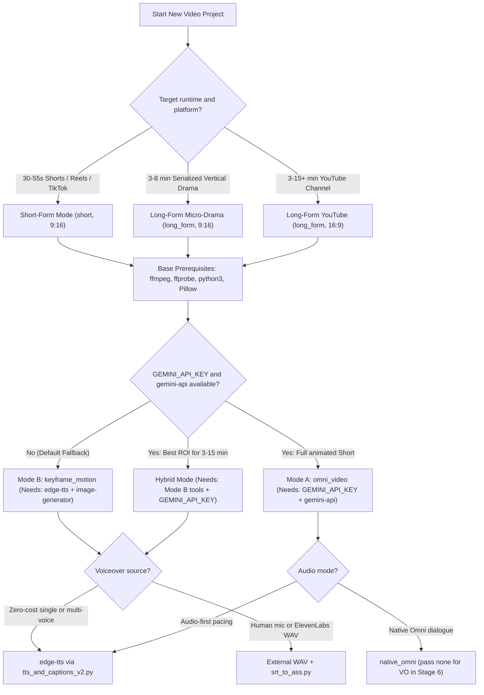
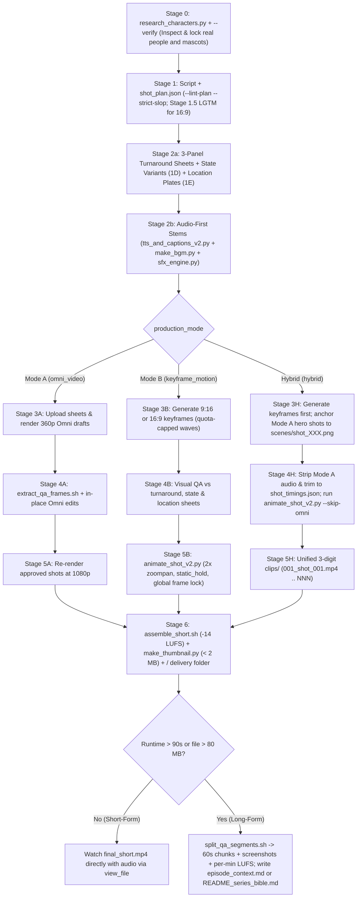

# Video-creator-skills

Antigravity skills and plugins for video production:

- **`viral-animated-shorts/` (v4.1):** End-to-end animated Shorts (`30-55s`, `9:16`) and long-form multi-act animated episodes (`3-15+ min`, `9:16` vertical micro-dramas or `16:9` horizontal YouTube commentary and stories) from Stage 0 likeness checks to `-14 LUFS` mastered delivery in minimal `<slug>/` folders.
- **`trip-cinema-studio/` (Antigravity Plugin, v0.2.1):** Turns local folders, file lists, Google Drive folders, or Google Photos shared albums of raw trip photos and 80%-video 4K clips into a `16:9` cinematic travel film (or `9:16` teaser) with 7 declarative Style Packs, progressive-disclosure `platform_linux.md` / `platform_macos.md` routing, HLG-vs-PQ HDR decode, EDL v2.0 privacy and aspect linting, EDL-aware QA sheets/telemetry, and a 3-persona `/swarm` review panel.
- **`clear-natural-english/`:** Keeps narration, YouTube metadata, and docs plain and free of AI filler.

## Modes and use cases

`viral-animated-shorts/` separates three orthogonal settings inside `shot_plan.json` so you can combine any format with any render engine and art style:

1. **Video format (`video_format` + `aspect_ratio`):** Short (`9:16`), Long-Form Vertical Micro-Drama (`9:16`), or Long-Form YouTube Episode (`16:9`).
2. **Production mode (`production_mode`):** **Mode B (`keyframe_motion`)**, **Mode A (`omni_video`)**, or **Hybrid (`hybrid`)**.
3. **Art style (`mode`):** `2d_stickman_in_3d` for fast commentary and comedy, or `stylized_3d` for cinema and drama.

### Video formats and use cases

| Format (`video_format` + `aspect_ratio`) | Best use cases | Runtime and shot budget | Pacing, hooks, and audio | Captions and ending | Packaging deliverables |
| :--- | :--- | :--- | :--- | :--- | :--- |
| **Short-Form (`short`, `9:16`)** | Daily breaking news, tech commentary, comedy skits, channel discovery (YouTube Shorts, Reels, TikTok) | `30-55s` (`95-115` words, `10-14` shots, hard cap `59.0s`) | Cold open at `0:00`, motion in `0-0.5s`, `<= 3.5s` avg shot; single voice (`+10%` default rate), retrieved or procedural BGM | Burned-in kinetic `86px` (`<= 18` chars, `MarginV=420`, `+/-2.5 deg` tilt); `replay_loop` (`loop_bridge` + dual-anchor Shot 1) | `<slug>/` folder: `<slug>-short.mp4`, `< 2 MB` `9:16` `thumbnail.png`, linted `packaging.md` |
| **Long-Form Vertical Micro-Drama (`long_form`, `9:16`)** | Serialized binge dramas (palace/thriller/romance episodes for TikTok Series, Reels, Shorts feeds) | `3-8 min` (`4-5` Acts, `750-1,100` words, `80-120` shots) | Cold open at `0:00` + re-hook every `25-45s`, `~3.2-3.6s` avg shot; multi-voice `voice_cast` (`+13%..+18%`), Act-aware BGM (`palace_drama` / `epic_story`) | Speaker-accented kinetic or `clean_subtitle` (`9:16`); serialized `cliffhanger` (`dual_anchor_loop: false`) | `<slug>/` folder + `README_series_bible.md` (Ep 2+ continuity), `chapters.txt` |
| **Long-Form YouTube Episode (`long_form`, `16:9`)** | High-RPM AdSense commentary, daily news briefings, animated documentaries, deep-dive explainers | `3-15+ min` (`3-6` Chapters; `100-115 WPM` commentary = ~300w/3m or ~525w/5m) | `0-5s` title/thumbnail payoff, Stage 1.5 Pre-Render LGTM gate, Anchor vs. Skeptic dual hosts (`+6%..+10%`), Tech/UI editorial SFX (`ui_tick`, `data_chime`, `sub_whoosh`), 3-tier visual hierarchy | **Soft `captions.srt` CC recommended** (`caption_style: "none"`), or static `clean_subtitle` (`62px`, `MarginV=116`, `max_chars=36`, `tilt=0`); `static_hold` charts/End-Screen | `<slug>/` folder: `<slug>-episode.mp4`, `< 2 MB` `16:9` `thumbnail.png`, front-loaded `packaging.md`, `episode_context.md`, `chapters.txt` |

### Production modes (`production_mode`) and prerequisites

| Production mode | How it renders shots | Prerequisites and API keys | Relative cost and speed | Audio and timing control | Best fit |
| :--- | :--- | :--- | :--- | :--- | :--- |
| **Mode B: `keyframe_motion`** *(Default)* | Generates `9:16` or `16:9` keyframes from locked 3-panel turnaround/state/location sheets, then animates each still with 2x-supersampled FFmpeg camera presets (`animate_shot_v2.py`) | **Zero paid video API keys.** Requires `ffmpeg`, `ffprobe`, `python3`, Pillow (`PIL`), `edge-tts` (or own VO WAV), image generator (`image-generator` subagent or `gemini-api image`); `numpy` optional (faster BGM/SFX) | Lowest cost; fast and parallelizable across Acts (`--act`, `--workers`) | Exact audio-first frame lock (`<= 1` frame drift across 5+ min); full multi-voice `voice_cast` | Daily Shorts, 3-15 min explainers, and 90+ shot serialized dramas on a budget |
| **Mode A: `omni_video`** | Generates fluid character animation directly with Gemini Omni 1.2 Flash (`360p` draft -> QA & in-place edits -> `1080p` final) | `ffmpeg`, `ffprobe`, `python3`, Pillow (`PIL`), **`GEMINI_API_KEY`** + `gemini-api` CLI (or `google-genai` Python SDK) | Highest compute/API cost; slower on 60+ shots | `native_omni` (keep generated dialogue) OR `tts_plus_bgm` (`--strip-audio` + VO stem) | 30-55s showcase Shorts where fluid character acting and physical comedy drive the video |
| **Hybrid (`hybrid`)** | Mixes Mode A (`omni_video`) on 6-10 hero/hook/climax shots with Mode B (`keyframe_motion`) on dialogue, narration, and insert shots via per-shot `shots[].production_mode` | All Mode B prerequisites **plus** `GEMINI_API_KEY` + `gemini-api` CLI / `google-genai` SDK | Balanced ROI (spend video gen only on hooks and Act climaxes) | Shared audio-first `voiceover.wav` (strip Mode A audio, trim to exact `shot_timings.json` duration, run `animate_shot_v2.py --skip-omni`) | Flagship 3-15 min YouTube episodes and Episode 1 drama pilots |

## Mode selection and pipeline flowcharts

### 1. Choosing a mode and checking prerequisites

### 2. How each mode flows end-to-end (Stage 0 to Stage 6)

## Skills included

### `viral-animated-shorts/` (v4.1)

Seven-stage pipeline (Stage 0 to Stage 6) with a top-of-file progressive-disclosure routing table in [viral-animated-shorts/SKILL.md](./viral-animated-shorts/SKILL.md):

- **Stage 0 portrait verification (`research_characters.py`, Templates 1A-1E):** Splits `reference_downloaded` from `likeness_verified`, lists newly downloaded portraits under `uninspected_entities`, and locks visually inspected traits via `--verify <id> --traits "..."`.
- **Preflight TTS, slop, pacing, and prompt-hygiene linter (`tts_and_captions_v2.py`):** Fixes dual-host long-form commentary slop checks, catches compact currency, plural/possessive acronyms (`NPCs`, `MCP's`), resolutions (`1080p SDR`), credit grades (`AA-`), `3 AM`, spaced phonetic caption leaks, YouTube packaging slop (`--lint-metadata`), Short `> 59.0s` overruns (`SHORT_OVER_60S`), `16:9` commentary WPM/`>+12%` pacing, `SFX_TONE_MISMATCH`, literal `"blank signs"` (`LITERAL_BLANK_SIGN`), and text-magnet props (`TEXT_MAGNET_PROP`).
- **Aspect-ratio captions (`tts_and_captions_v2.py`, `srt_to_ass.py`):** `9:16` uses `86px` Fun Kinetic ASS (`MarginV=420`, `max_chars=18`, `+/-2.5 deg` tilt); `16:9` uses `captions.srt` CC (`caption_style: "none"`) or static `clean_subtitle` (`62px`, `MarginV=116`, `max_chars=36`, `tilt=0`).
- **Act-aware BGM and 26 calibrated SFX cues (`make_bgm.py`, `retrieve_music.py`, `sfx_engine.py`):** Includes 6 soft-calibrated Tech/UI documentary cues (`ui_tick`, `ui_click`, `data_chime`, `sub_whoosh`, `alert_ping`, `soft_thud`) alongside comedy and palace-drama suites, plus automatic `ambience_bed` forwarding from `shot_plan.json` into `shot_timings.json`.
- **Frame-locked animation and `16:9` commentary playbook (`animate_shot_v2.py`, `references/long_form_guide.md`):** 12 eased camera presets including zero-crop `static_hold` for data charts and End-Screen slates, Stage 1.5 Pre-Render LGTM gate, Anchor vs. Skeptic dual-host rules, 3-tier visual hierarchy, and `episode_context.md` continuity.
- **Hardened thumbnail builder and minimal `<slug>/` delivery (`make_thumbnail.py`, `references/batch_and_delivery.md`):** Cross-platform fonts, fast scrim gradients, `< 2 MB` auto-cap, safe-zone clamping, `--right-image` split canvas, `--mobile-preview` 160px check, Topic Coordinator + Flash Worker hierarchy, quota-aware wave caps, 4-dimension dedup, Zero-Bloat Drive folders, and a 24-column production log.

### `trip-cinema-studio/` (Antigravity Plugin, v0.2.1)

Full Antigravity plugin (`plugin.json`, `hooks.json`, `rules/AGENTS.md`, `agents/`, `skills/trip-cinema/`) with progressive-disclosure `references/platform_linux.md` and `references/platform_macos.md` routing. See [trip-cinema-studio/README.md](./trip-cinema-studio/README.md) for setup and architecture:

- **7 Declarative Style Packs and 4-Gate review loop:** Video-First `1800x360` timeline strips, Gate 2 `1280x720` 4-Card Style-Pack Carousel (both Linux `generate_look_previews.py --style-ids` and macOS `macos_style_previews.jxa`), Gate 3 beat/energy BGM picker, and Gate 4 linted EDL v2.0 storyboard.
- **Hardened Python/FFmpeg renderer and EDL v2.0 linter (`render_trip.py`, `lint_edl.py`):** Separate HLG (`arib-std-b67`) vs. PQ (`smpte2084`) Rec.709 conversion, glitch-free transitions without baked fade collisions, video-only probed `xfade` offsets, cut-aligned segment assembly with `--workers` and `--reuse-cache`, portrait speed ramps + `vidstab`, `focal_anchor` collage framing + `> 1.85x` aspect lint, `rendered_card_path` passthrough, and deterministic `--gates-state` Gate 1 privacy bans.
- **EDL-aware QA extraction, fresh-flag stop hook, and 3-persona `/swarm` panel:** Generates `qa_video_alignment.jpg`, `qa_chapter_cards.jpg`, `qa_collages.jpg`, `qa_transitions.jpg`, and `qa_metrics.json` (`signalstats` + duration drift), audited by `review-director`, `review-cinematographer`, and `review-family-member` before `hooks/qa_stop_guard.sh` allows delivery.

### `clear-natural-english/`

Writes, rewrites, reviews, and edits English prose so it reads easily on the first pass and stays free of AI slop. Use it standalone for emails, docs, updates, proposals, and READMEs, or alongside `viral-animated-shorts/` for voiceover lines, YouTube titles, descriptions, and pinned comments. Includes concrete before-and-after examples in `clear-natural-english/references/patterns-and-examples.md`.

## Production scripts (`viral-animated-shorts/scripts/`)

| Script | Stage | Purpose |
| :--- | :--- | :--- |
| `research_characters.py` | Stage 0 | Pure-stdlib character and mascot verifier (local registry, `--user-ref`, Wikipedia REST API portrait cache, `uninspected_entities` tracking, and `--verify <id> --traits`). |
| `tts_and_captions_v2.py` | Stage 1 & 2 | Lints narration, metadata (`--lint-metadata`), prompt hygiene, SFX tone, and pacing; synthesizes single-voice or multi-voice `edge-tts` (honoring `plan.rate`, `plan.pitch`, `plan.max_caption_chars`, `ambience_bed`); writes `shot_timings.json`, `chapters.txt`, `captions.ass`, and `captions.srt`. |
| `srt_to_ass.py` | Stage 6 | Converts `.srt` files into zero-overlap ASS captions for `9:16` (`86px`, `max-chars 18`, `margin-v 420`) or `16:9` (`62px`, `max-chars 36`, `margin-v 116`, `tilt 0`, `clean_subtitle`). |
| `sfx_engine.py` | Stage 2 | RMS-calibrated procedural SFX renderer (`sfx_track.wav`) with 26 comedy, Tech/UI documentary, and cinematic/drama cues, 3-variant caching, `sfx_pan`, and auto-wired `ambience_bed` room-tone beds. |
| `retrieve_music.py` | Stage 2 | Fetches instrumental BGM tracks (`10.5 kHz` acoustic-safe LP) across all 8 moods, forwarding `--timings` to `make_bgm.py` fallback when offline. |
| `make_bgm.py` | Stage 2 | Synthesizes procedural BGM (`dramatic_news`, `cinematic_tension`, `miami_pop`, `retro_drive`, `tech_pulse`, `comedy_quirk`) plus Act-aware long-form scores (`palace_drama`, `epic_story`). |
| `animate_shot_v2.py` | Stage 3 | Animates `9:16` or `16:9` keyframes with global cumulative frame lock, parallel `--act`/`--workers`/`--skip-existing`/`--skip-omni` slicing, 12 eased camera presets (including zero-crop `static_hold`), `focal_anchor`, and per-shot fades. |
| `extract_qa_frames.sh` | Stage 4 | Extracts `f_frame0`, `f_start`, `f_mid`, `f_peak`, and `f_end` (`-sseof -0.05`, plus previous shot's end frame) for per-shot frame QA. |
| `assemble_short.sh` | Stage 6 | Verifies zero `CAPTION_OVERLAP`, fast-path `-c copy` concats matching `9:16` or `16:9` clips, mixes 3 stems in lossless 24-bit PCM with single-carve BGM and musical ducking, burns ASS captions, and verifies post-norm `-14 LUFS`. |
| `split_qa_segments.sh` | Stage 6 | Slices long-form MP4s (`> 90s` / `> 80 MB`) into lossless 60-second `qa_min*.mp4` chunks (`< 100 MB` each), extracts 10 screenshots, reports full + per-segment LUFS, and writes validated YouTube `chapters.txt`. |
| `make_thumbnail.py` | Stage 6 | Cross-platform YouTube cover/thumbnail builder (`9:16` and `16:9`) with safe-zone text clamping, fast scrim gradients, `< 2 MB` auto-cap, `--right-image` split canvas, and `--mobile-preview` 160px legibility check. |

