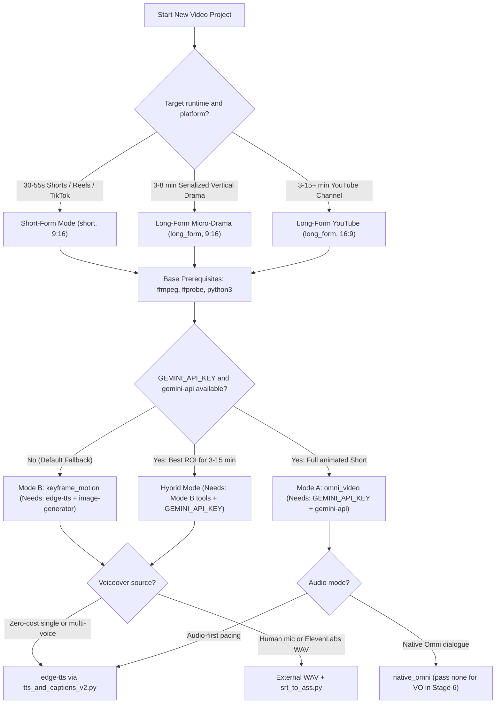
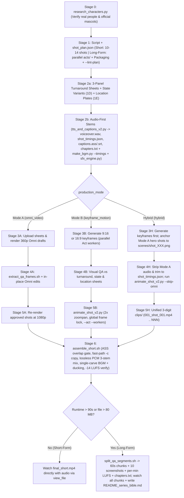

# Video-creator-skills

Antigravity skills and plugins for video production:

- **`viral-animated-shorts/` (v4.0):** End-to-end animated Shorts (`30-55s`, `9:16`) and long-form multi-act animated episodes (`3-15+ min`, `9:16` vertical micro-dramas or `16:9` horizontal YouTube episodes) from character research to mastered `-14 LUFS` export.
- **`trip-cinema-studio/` (Antigravity Plugin, v0.1.0):** Turns raw folders, file lists, or Google Drive albums of real trip photos and video clips into a finished `16:9` cinematic travel film with EXIF/GPS chaptering, a 4-gate visual/audio Artifact review loop, cross-platform FFmpeg/Remotion scripts plus a zero-dependency macOS native `AVFoundation`/`CoreImage` batched engine, shot-targeted alignment QA, and a 3-persona `/swarm` film review panel.
- **`clear-natural-english/`:** Keeps narration, YouTube metadata, and docs plain and free of AI filler.

---

## Modes and Use Cases

`viral-animated-shorts/` separates **three orthogonal settings** inside `shot_plan.json` so you can combine any format with any render engine and art style:

1. **Video Format (`video_format` + `aspect_ratio`):** What you are making (Short vs. Long-Form `9:16` vs. Long-Form `16:9`).
2. **Production Mode (`production_mode`):** How shots are rendered (**Mode B `keyframe_motion`**, **Mode A `omni_video`**, or **`hybrid`**).
3. **Art Style (`mode`):** Visual aesthetic (`2d_stickman_in_3d` for fast comedic commentary vs. `stylized_3d` for cinema/drama).

### Video Formats and Use Cases

| Format (`video_format` + `aspect_ratio`) | Best Use Cases | Runtime & Shot Budget | Pacing, Hooks & Audio | Captions & Ending | Packaging Deliverables |
| :--- | :--- | :--- | :--- | :--- | :--- |
| **Short-Form (`short`, `9:16`)** | Daily breaking news, tech commentary, comedy skits, rapid channel discovery (YouTube Shorts, Reels, TikTok) | `30-55s` (`95-115` words, `10-14` shots) | Cold open at `0:00`, motion in `0-0.5s`, `<= 3.5s` avg shot; single voice (`+6%`), retrieved or procedural BGM | Burned-in kinetic `86px` (`<= 18` chars, `MarginV=420`, `+/-2.5 deg` tilt); `replay_loop` (`loop_bridge` + dual-anchor Shot 1) | `9:16` cover frame, title, description, pinned comment |
| **Long-Form Vertical Micro-Drama (`long_form`, `9:16`)** | Serialized binge dramas (palace/thriller/romance episodes for TikTok Series, Reels, Shorts feeds) | `3-8 min` (`4-5` Acts, `750-1,100` words, `80-120` shots) | Cold open at `0:00` + re-hook every `25-45s`, `~3.2-3.6s` avg shot; multi-voice `voice_cast` (`+13%..+18%`), Act-aware BGM (`palace_drama` / `epic_story`) | Speaker-accented kinetic or `clean_subtitle` (`9:16`); serialized `cliffhanger` (`dual_anchor_loop: false`) | `9:16` cover frame, `README_series_bible.md` (Ep 2+ continuity), Part 2 pinned comment, `chapters.txt` |
| **Long-Form YouTube Episode (`long_form`, `16:9`)** | High-RPM AdSense channels, animated documentaries, deep-dive explainers, lore stories | `3-15+ min` (`3-6` Chapters, `500-2,200+` words, `45-180+` shots) | `0-5s` title/thumbnail payoff, `0-20s` brisk hook cuts, re-hooks every `45-90s`, `3.5-6.5s` avg shot; multi-voice `edge-tts` or human/ElevenLabs VO | **Soft `captions.srt` CC recommended** (`caption_style: "none"`), or static `clean_subtitle` (`62px`, `MarginV=96`, `max_chars=36`, `tilt=0`); `outro` (8-12s End-Screen slate) or `cliffhanger` | 2-3 A/B `16:9` thumbnails, non-spoiler `chapters.txt`, description + AI disclosure, pinned comment |

### Production Modes (`production_mode`) and Prerequisites

| Production Mode | How It Renders Shots | Prerequisites & API Keys | Relative Cost & Speed | Audio & Timing Control | Best Fit |
| :--- | :--- | :--- | :--- | :--- | :--- |
| **Mode B: `keyframe_motion`** *(Default)* | Generates `9:16` or `16:9` keyframes from locked 3-panel turnaround/state/location sheets, then animates each still with 2x-supersampled FFmpeg camera presets (`animate_shot_v2.py`) | **Zero paid video API keys.** Requires `ffmpeg`, `ffprobe`, `python3`, `edge-tts` (or own VO WAV), image generator (`image-generator` subagent or `gemini-api image`); `numpy` optional (faster BGM/SFX) | Lowest cost; fast & parallelizable across Acts (`--act`, `--workers`) | Exact audio-first frame lock (`<= 1` frame drift across 5+ min); full multi-voice `voice_cast` | Daily Shorts, 3-15 min explainers, and 90+ shot serialized dramas on a budget |
| **Mode A: `omni_video`** | Generates fluid character animation directly with Gemini Omni 1.2 Flash (`360p` draft -> QA & in-place edits -> `1080p` final) | `ffmpeg`, `ffprobe`, `python3`, **`GEMINI_API_KEY`** + `gemini-api` CLI (or `google-genai` Python SDK) | Highest compute/API cost; slower on 60+ shots | `native_omni` (keep generated dialogue) OR `tts_plus_bgm` (`--strip-audio` + VO stem) | 30-55s showcase Shorts where fluid character acting and physical comedy drive the video |
| **Hybrid (`hybrid`)** | Mixes Mode A (`omni_video`) on 6-10 hero/hook/climax shots with Mode B (`keyframe_motion`) on dialogue, narration, and insert shots via per-shot `shots[].production_mode` | All Mode B prerequisites **plus** `GEMINI_API_KEY` + `gemini-api` CLI / `google-genai` SDK | Balanced ROI (spend video gen only on hooks & Act climaxes) | Shared audio-first `voiceover.wav` (strip Mode A audio, trim to exact `shot_timings.json` duration, run `animate_shot_v2.py --skip-omni`) | Flagship 3-15 min YouTube episodes and Episode 1 drama pilots |

---

## Mode Selection and Pipeline Flowcharts

### 1. Choosing a Mode and Checking Prerequisites

### 2. How Each Mode Flows End-to-End (Stage 0 to Stage 6)

---

## Skills Included

### `viral-animated-shorts/` (v4.0)

Seven-stage pipeline (Stage 0 to Stage 6) for 2D stickman-in-3D and stylized 3D animated Shorts and long-form episodes. Key capabilities:

- **Stage 0 verification & continuity sheets (`research_characters.py`, Templates 1A-1E):** Verifies public figures and official mascots via local registry, `--user-ref`, and Wikipedia REST API. Adds multi-state character turnaround sheets (`characters[].state_sheets`, e.g., veiled vs. unveiled) and master empty-set location plates (`locations[]`, Template 1E) to prevent `OFF_MODEL_CHARACTER`, `STATE_CONTINUITY_DRIFT`, and architectural drift across 90+ shots.
- **Multi-voice concurrent TTS & genre-aware anti-slop linting (`tts_and_captions_v2.py`):** Routes characters through top-level `voice_cast`, synthesizes with bounded concurrency (`--concurrency 4`) and exponential retry backoff, honors per-shot `post_gap_sec` Act pauses and silent reaction beats, emits `acts[]` and `chapters.txt`, separates clean display captions from `tts_pronunciations`/`tts_text`, and runs `--lint-plan` (`TTS_MISREAD` + genre/speaker-aware `AI_SLOP_SCRIPT`).
- **Aspect-ratio aware captions (`tts_and_captions_v2.py`, `srt_to_ass.py`):**
  - `9:16` (`1080x1920`): `86px` Fun Kinetic lower-third ASS (`--margin-v 420`, `--max-chars 18`, `+/-2.5 deg` tilt, `--keyword-color auto|palace` or speaker hex), plus `clean_subtitle` for calm long-form drama.
  - `16:9` (`1920x1080`): `caption_style: "none"` + auto-exported `captions.srt` for YouTube CC (recommended), or static `clean_subtitle` (`62px`, `--margin-v 96` to clear YouTube's scrub bar, `--max-chars 36`, `--tilt 0`).
- **Act-aware procedural BGM, spotted silence & calibrated SFX (`make_bgm.py`, `retrieve_music.py`, `sfx_engine.py`):** Passing `--timings audio/shot_timings.json` to `make_bgm.py` (`palace_drama`, `epic_story`) scores each Act by `acts[].bgm_intensity`, honors `ending_style: "cliffhanger"` tension holds, and automates spotted-silence drops (`shots[].bgm_cue`). `sfx_engine.py` renders 20 RMS-calibrated cues with 3-variant caching, stereo panning (`sfx_pan`), and optional `--ambience` room-tone beds.
- **Frame-locked cinematic animation (`animate_shot_v2.py`):** Global cumulative frame lock before `--act` / `--start-idx` / `--end-idx` / `--shot-ids` slicing, `--workers`, `--skip-existing`, `--skip-omni` (for Hybrid runs), 11 eased camera presets (adding `slow_dolly_in`, `tilt_up`, `tilt_down`), `focal_anchor` (so `16:9` rule-of-thirds zooms don't drift off-subject), isotropic Frame-0 `shake_zoom`, per-shot `fade_in`/`fade_out`, and 2x supersampling for `9:16` and `16:9`.
- **Fast-path `-c copy` assembly & chunked 60s multimodal QA (`assemble_short.sh`, `split_qa_segments.sh`):** Auto-detects `9:16` vs `16:9`, validates `time_base`/SAR/stereo before fast-path `-c copy`, mixes 3 stems in lossless 24-bit PCM with peak limiting and single-point speech carving (`10.5 kHz` LP, `-3.0 dB @ 2.9 kHz`, smooth musical sidechain ducking) before 2-pass `-14 LUFS` (`LRA=7` on `9:16`, `LRA=9` on `16:9`) + post-norm verification. For long-form videos, `split_qa_segments.sh` slices lossless 60s chunks (`< 100 MB` each), extracts 10 screenshots, logs per-segment LUFS, and validates YouTube `chapters.txt`.

### `trip-cinema-studio/` (Antigravity Plugin, v0.1.0)

Full Antigravity plugin (`plugin.json`, `hooks.json`, `rules/AGENTS.md`, `agents/`, `skills/trip-cinema/`) for turning raw folders, file lists, or Google Drive albums of trip photos and video clips into a standalone `16:9` cinematic travel film (`1080p`/`4K`, `-14 LUFS`, `LRA=9`, no voiceover). See [`trip-cinema-studio/README.md`](./trip-cinema-studio/README.md) for setup and usage. Key capabilities:

- **Read-only safety hooks & authenticity guardrails (`hooks/raw_media_guard.sh`, `rules/AGENTS.md`):** Blocks destructive commands (`rm`, `mv`, `ffmpeg -y`) against original trip media and forbids generative I2V on close-ups of real family or friends.
- **Interactive 4-gate Artifact review loop:** Produces visual/audio Artifacts before final rendering—**(1) Chapters & VIP People** contact sheets, **(2) Color Look, Title & Vertical Layout** real-photo previews (`Warm Film`, `Moody Teal-Orange`, `Clean Natural`, `Soft Atmospheric`, plus `split_diptych_pair` vs. `blurred_bg_pillarbox`), **(3) BGM & Pacing** auditionable CC-BY/CC0 + optional `lyria-3.5` previews, and **(4) Visual Storyboard & Cost Sign-Off**.
- **Dual render engines (Cross-Platform + Zero-Dependency macOS Native):** Ships Python/FFmpeg/Remotion scripts (`ingest_trip.py`, `generate_look_previews.py`, `bgm_analyzer.py`, `lint_edl.py`, `render_trip.py`, `remotion_template/`) plus a zero-external-dependency Apple-signed JXA engine (`scripts/macos_native/`) using `AVFoundation` + `CoreImage` with low-impact sequential `nice -n 15` chapter batching, explicit portrait video orientation mapping, and blurred photo-backdrop editorial chapter/route-map cards.
- **Shot-targeted alignment QA & 3-persona `/swarm` review panel (`agents/`):** Extracts 100% of video mid-frames (`qa_video_alignment.jpg`) and chapter/route cards (`qa_chapter_cards.jpg`) via `--edl`, then runs `review-director`, `review-cinematographer`, and `review-family-member` before final delivery.

### `clear-natural-english/`

Writes, rewrites, reviews, and edits English prose so it reads easily on the first pass and stays free of AI slop. Use it standalone for emails, docs, updates, proposals, and READMEs, or alongside `viral-animated-shorts/` for voiceover lines, YouTube titles, descriptions, and pinned comments. Includes concrete before-and-after examples in `clear-natural-english/references/patterns-and-examples.md`.

---

## Production Scripts (`viral-animated-shorts/scripts/`)

| Script | Stage | Purpose |
| :--- | :--- | :--- |
| `research_characters.py` | Stage 0 | Pure-stdlib character and mascot verifier (local registry, `--user-ref`, and Wikipedia REST API portrait cache to `character_references.json`). |
| `tts_and_captions_v2.py` | Stage 1 & 2 | Lints narration (`--lint-plan`, `--strict-slop`, `--no-slop-check`), synthesizes single-voice or multi-voice `edge-tts` (`voice_cast`, `--concurrency`, `--max-retries`, `post_gap_sec`, `tts_pronunciations`), writes `shot_timings.json` (`acts[]`), `chapters.txt`, `captions.ass` (`kinetic_keyword`, `karaoke_chunk`, `clean_subtitle`, or `none`), and `captions.srt` (`--export-srt`). |
| `srt_to_ass.py` | Stage 6 | Converts `.srt` files (including human mic / ElevenLabs transcripts) into zero-overlap ASS captions for `9:16` (`86px`, `max-chars 18`, `margin-v 420`) or `16:9` (`62px`, `max-chars 36`, `margin-v 96`, `tilt 0`, `clean_subtitle`). |
| `sfx_engine.py` | Stage 2 | RMS-calibrated procedural SFX renderer (`sfx_track.wav`) with 20 comedy and cinematic/drama cues, 3-variant caching, `sfx_pan`, and optional `--ambience` room-tone beds. |
| `retrieve_music.py` | Stage 2 | Fetches instrumental BGM tracks (`10.5 kHz` acoustic-safe LP) across all 8 moods, forwarding `--timings` to `make_bgm.py` fallback when offline. |
| `make_bgm.py` | Stage 2 | Synthesizes procedural BGM (`dramatic_news`, `cinematic_tension`, `miami_pop`, `retro_drive`, `tech_pulse`, `comedy_quirk`) plus Act-aware long-form scores (`palace_drama`, `epic_story`) honoring `acts[].bgm_intensity`, `ending_style: "cliffhanger"`, and `shots[].bgm_cue` spotted silence. |
| `animate_shot_v2.py` | Stage 3 | Animates `9:16` or `16:9` keyframes with global cumulative frame lock, parallel `--act`/`--workers`/`--skip-existing`/`--skip-omni` slicing, 11 eased camera presets (including `slow_dolly_in`, `tilt_up`, `tilt_down`), `focal_anchor`, and per-shot fades. |
| `extract_qa_frames.sh` | Stage 4 | Extracts `f_frame0`, `f_start`, `f_mid`, `f_peak`, and `f_end` (`-sseof -0.05`, plus previous shot's end frame) for per-shot frame QA. |
| `assemble_short.sh` | Stage 6 | Verifies zero `CAPTION_OVERLAP`, fast-path `-c copy` concats matching `9:16` or `16:9` clips (checking `time_base` + SAR + stereo), mixes 3 stems in lossless 24-bit PCM with single-carve BGM and musical ducking, burns ASS captions (2s keyframe cadence), and verifies post-norm `-14 LUFS`. |
| `split_qa_segments.sh` | Stage 6 | Slices long-form MP4s (`> 90s` / `> 80 MB`) into lossless 60-second `qa_min*.mp4` chunks (`< 100 MB` each), extracts 10 screenshots, reports full + per-segment LUFS, and writes validated YouTube `chapters.txt`. |
